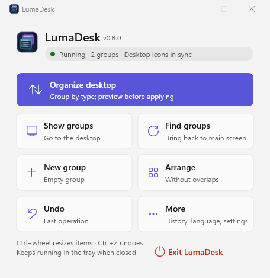
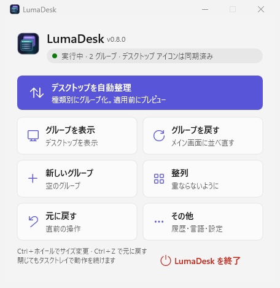
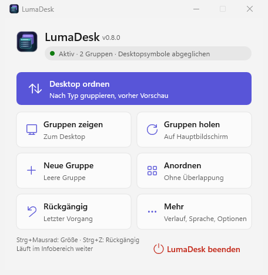
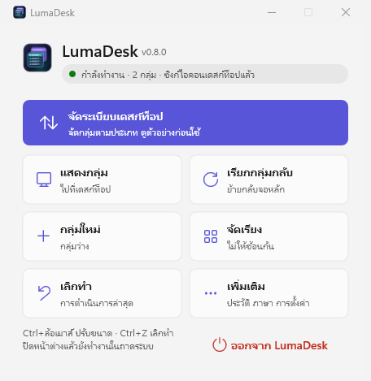

# LumaDesk


A lightweight, native desktop icon organizer for Windows 11, written in Rust with Win32, Direct2D and DirectWrite. No Electron, no WebView, no background services.


[繁體中文說明](README.zh-TW.md)

## What it does

LumaDesk draws groups directly on the desktop and shows your desktop icons inside them. **It only organizes icons: files, folders, programs and shortcuts stay exactly where they are.** Grouping, moving between groups, sorting and ungrouping only change LumaDesk's references; nothing is moved, copied, renamed or hidden.

- **Organize the desktop** – scans your personal and public desktop, previews the result by type (web links, documents, pictures, media, archives, folders, programs, scripts, other) and applies it after you confirm.
- **Auto-file new items** – new files that appear on the desktop go into their category group (optional, on by default).
- **Explorer-like groups** – large icons, small icons, list and details views; sort by name, date, type or size; resizable details columns; Ctrl+mouse wheel changes the item size.
- **Familiar handling** – double-click or Enter to open, the native Windows context menu, F2 to rename, Delete / Shift+Delete like Explorer, type to select, Ctrl+F search, multi-select with Ctrl / Shift.
- **Tidy layout** – groups snap to each other and to the screen edges, can be collapsed, rearranged without overlaps, or brought back to the main screen. Frosted background that follows your wallpaper; light and dark themes.
- **Safe** – Ctrl+Z undoes the last 20 operations, even after a restart. Original icon positions are journaled and restored when you ungroup or exit, with a separate watchdog if LumaDesk stops unexpectedly.
- **12 languages** – see below.

## Languages

繁體中文, 简体中文, English, 日本語, 한국어, Deutsch, Français, Español, Português (Brasil), Русский, Tiếng Việt, ไทย.

LumaDesk follows the Windows display language and can be switched live under **More › Language** or in the tray menu. Existing group names are never renamed when the language changes. Translations other than Traditional Chinese are machine-made; corrections are very welcome.

| English | 日本語 | Deutsch | ไทย |
| --- | --- | --- | --- |
|  |  |  |  |

## Install

Download `LumaDesk-<version>-windows-x64.zip` from the releases page, extract it and run `lumadesk.exe`. To install per user, run `Install-LumaDesk.ps1` from the extracted folder (no administrator rights needed); `Uninstall-LumaDesk.ps1` removes the program and keeps your settings. Exit LumaDesk from the tray before uninstalling so desktop icons are restored.

Requirements: Windows 11 x64 (Windows 10 may work but is not tested). The preview builds are not code-signed, so SmartScreen may ask for confirmation.

## Build from source

Install Rust (the version is pinned in `rust-toolchain.toml`) with the MSVC toolchain and the Windows C++ build tools, then:

```powershell
cargo build --release --locked
.\target\release\lumadesk.exe
```

Checks that CI runs:

```powershell
cargo fmt --check
cargo clippy --all-targets --locked -- -D warnings
cargo test --locked
cargo build --release --locked
powershell -NoProfile -ExecutionPolicy Bypass -File scripts/package.ps1 -SkipBuild
```

`scripts/smoke.ps1` runs an interactive end-to-end check against an isolated app-data folder and test files it creates itself; close LumaDesk first and run it in a normal desktop session. See [docs/ARCHITECTURE.md](docs/ARCHITECTURE.md) and [docs/PERFORMANCE.md](docs/PERFORMANCE.md) for internals and measurements.

## Privacy

LumaDesk works offline. It has no telemetry, no update checks and no network access. Settings are stored in `%APPDATA%\LumaDesk\layout.json` with an automatic backup; nothing leaves your computer.

## Status

LumaDesk is a preview. Mixed-DPI setups, monitor hot-plugging, accessibility and running alongside other desktop managers have not been fully verified. Please report issues with your Windows version, monitor/DPI setup and steps to reproduce, and avoid screenshots that show personal file names.

## License

[MIT](LICENSE). LumaDesk is an independently developed open-source project.
