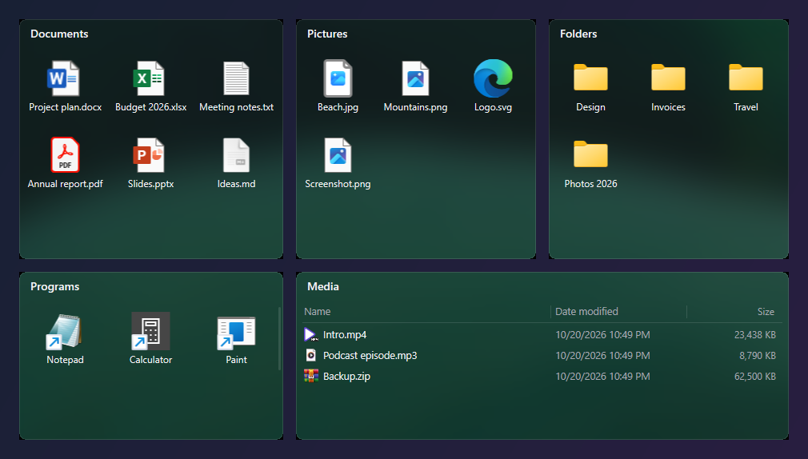

# LumaDesk


輕量、原生的 Windows 11 桌面圖示整理工具，使用 Rust、Win32、Direct2D 與 DirectWrite 開發，不需要 Electron、WebView 或背景服務。



[English](README.md)

## 功能

LumaDesk 直接在桌面上建立分組，並把桌面圖示顯示在分組中。**它只整理圖示：檔案、資料夾、程式與捷徑都留在原本的位置。** 分組、跨組移動、排序與取消分組只更動 LumaDesk 的參照，不搬移、不複製、不改名、不隱藏任何檔案。

- **自動整理桌面**：掃描個人與公用桌面，依類型（應用捷徑、文件、圖片、影音、壓縮檔、資料夾、程式、腳本、其他）預覽，確認後才套用。
- **自動收納新檔案**：之後出現在桌面的新檔案會放進對應分組（可關閉，預設開啟）。
- **像檔案總管的分組**：大圖示、小圖示、清單、詳細資料四種檢視；依名稱、日期、類型、大小排序；可調整欄寬；Ctrl＋滾輪調整項目大小。
- **熟悉的操作**：雙擊或 Enter 開啟、Windows 原生右鍵選單、F2 重新命名、Delete／Shift+Delete 與檔案總管相同、直接輸入跳到項目、Ctrl+F 搜尋、Ctrl／Shift 多選。
- **整齊的版面**：分組會互相對齊與貼齊螢幕邊緣，可收合、一鍵不重疊排列、找回跑出畫面的分組。跟隨桌布的霧面背景，支援明亮與深色。
- **安全**：Ctrl+Z 可復原最近 20 筆操作，重開後仍可用。原圖示位置會先記錄，取消分組或結束時還原；程式意外停止時另有監護程序還原。
- **12 種介面語言**：見下方。

## 介面語言

繁體中文、简体中文、English、日本語、한국어、Deutsch、Français、Español、Português (Brasil)、Русский、Tiếng Việt、ไทย。

預設跟隨 Windows 顯示語言，可在「更多 → 語言」或系統匣選單即時切換。切換語言不會改名已有的分組。除繁體中文外，翻譯為機器翻譯，歡迎協助修正。

## 安裝

從 Releases 下載 `LumaDesk-<版本>-windows-x64.zip`，解壓縮後執行 `lumadesk.exe`。若要安裝到使用者資料夾，可在解壓縮的資料夾執行 `Install-LumaDesk.ps1`（不需系統管理員權限）；`Uninstall-LumaDesk.ps1` 會移除程式並保留設定。移除前請先從系統匣結束 LumaDesk，讓桌面圖示恢復。

需求：Windows 11 x64（Windows 10 可能可用，但未測試）。預覽版尚未數位簽章，SmartScreen 可能會要求確認。

詳細操作請見 [中文操作說明](docs/操作說明.zh-TW.md)。

## 從原始碼編譯

安裝 Rust（版本固定於 `rust-toolchain.toml`）、MSVC 工具鏈與 Windows C++ 建置工具，然後執行：

```powershell
cargo build --release --locked
.\target\release\lumadesk.exe
```

提交前請執行：

```powershell
cargo fmt --check
cargo clippy --all-targets --locked -- -D warnings
cargo test --locked
cargo build --release --locked
```

## 隱私

LumaDesk 完全離線運作，沒有遙測、沒有自動更新檢查，也不連網。設定存放在 `%APPDATA%\LumaDesk\layout.json`（含自動備份），資料不會離開你的電腦。

## 授權

[MIT](LICENSE)。LumaDesk 是獨立開發的開源專案。
